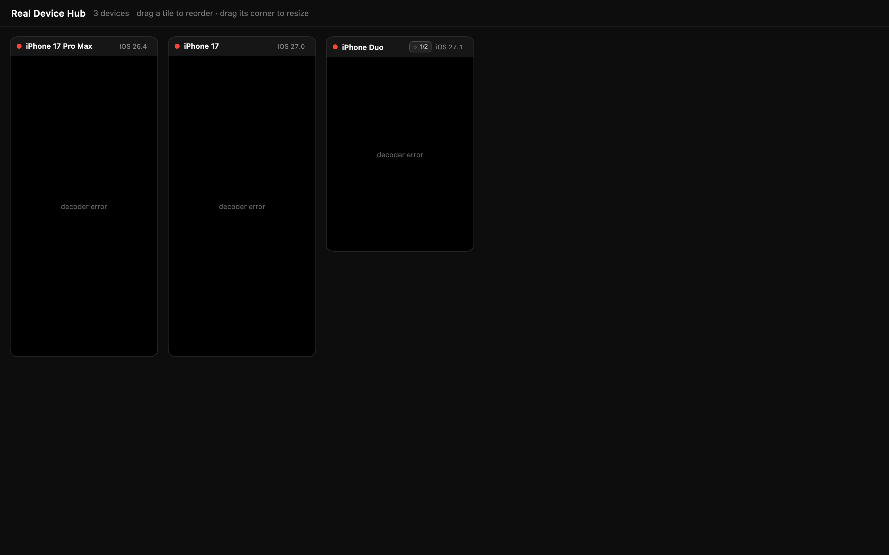

# Real Device Hub

A browser dashboard that shows **every booted iOS Simulator at once** as live
H.264 video — one tile per device, sized to that device's real screen
proportions, freely rearranged and resizable.



```bash
real-device-hub            # run in the foreground, opens the browser
real-device-hub start      # run in the background, opens the browser
real-device-hub stop       # shut it down
```

## Install

```bash
git clone git@github.com:zylcold/Real-Device-Hub.git
cd Real-Device-Hub
./install.sh                       # /usr/local/bin/real-device-hub
./install.sh --prefix ~/.local     # or anywhere else
```

Or without installing:

```bash
swift build -c release
./.build/release/RealDeviceHub
```

macOS needs **Screen Recording** permission for the app that launches the
service. It prompts the first time; grant it in System Settings → Privacy &
Security → Screen Recording and restart that app.

## Commands

| Command | What it does |
|---|---|
| `real-device-hub` / `serve` | Run in the foreground. Opens the dashboard. Ctrl-C stops it. |
| `real-device-hub start` | Run in the background, then open the dashboard. |
| `real-device-hub stop` | Stop a service started with `start`. |
| `real-device-hub status` | Whether it is running, on which port, and what is booted. |
| `real-device-hub list` | Booted simulators, with screen counts. |
| `real-device-hub help` | Full usage. |

Options: `-p, --port <n>`, `--no-open`, `-h, --help`.

`serve` owns the process, so closing the terminal stops the service. `start`
detaches it and records the pid and port in `~/.real-device-hub.state`; `stop`
reads that file. Logs for a backgrounded run go to `~/.real-device-hub.log`.

## The dashboard

- **One tile per device**, at the screen's real aspect ratio — an iPhone and an
  iPad-sized device do not get the same box.
- **Drag the title bar** to rearrange. Tiles re-pack from the top-left, gapless.
- **Drag the bottom-right corner** to resize, freely. Widths are not snapped to
  a grid, so a tile's height always follows the screen's real ratio and the
  image is never distorted.
- **Any number of viewers.** Frames are broadcast per device, so a second tab or
  another browser joins in rather than kicking the first one off.
- **Multi-screen devices** get a `⟳` button in the title bar to flip between
  screens. iPhone Duo reports two `Display class: 0` framebuffers and Simulator
  opens a window per screen; screen 0 is the device's first framebuffer. Only
  one screen streams at a time, so a ten-screen device still costs one encoder.
- A booted device with **no Simulator window** still gets a tile, saying so
  rather than spinning forever. Open the device in Simulator.app and the tile
  starts on its own.
- Devices and windows are re-checked every 2 seconds. No reload, ever.

## How it works

One `SCStream` per screen being watched, each with its own VideoToolbox H.264
encoder, each over its own WebSocket:

```
Browser  ──GET /api/devices────────►  HTTP server  ◄── xcrun simctl list devices booted -j
   │                                    │                 xcrun simctl io <udid> enumerate
   ├──GET /ws?udid=…&screen=0 ────────►│  ScreenCaptureKit: Simulator windows
   │        ▲                            │  (title = device name, never a udid)
   └────H.264 frames────────────────────┘
```

| File | Role |
|---|---|
| `Sources/CLI.swift` | `serve` / `start` / `stop` / `status` / `list`, state file, auto-open |
| `Sources/StreamingApp.swift` | wires devices and screens to sockets, broadcasts to every viewer |
| `Sources/Fleet.swift` | actor keeping captures in sync with what is on screen, lazily per screen |
| `Sources/SimDevice.swift` | simctl enumeration, window↔device pairing, chrome calibration, screen ordering |
| `Sources/DeviceCapture.swift` | one `SCStream` + encoder per device screen |
| `Sources/HTTPServer.swift` | `/`, `/vendor/…`, `/api/devices`, `/ws?udid=&screen=` |
| `Sources/H264Encoder.swift` | from SimStream (VideoToolbox) |
| `browser/index.html` | the grid: one WebSocket and one `VideoDecoder` per tile, screen flip |
| `browser/vendor/packery.pkgd.js` | [Packery](https://github.com/metafizzy/packery) 3.0.0, MIT — gapless layout |
| `browser/vendor/draggabilly.pkgd.js` | [Draggabilly](https://github.com/metafizzy/draggabilly) 3.0.0, MIT — Packery's drag partner |

### Four things that are less obvious than they look

**Window ↔ device matching.** ScreenCaptureKit exposes a window title, never a
udid. The title is the device name, so two booted devices sharing a name across
runtimes are ambiguous; they get paired in simctl order and the server logs a
warning.

**Cropping the window chrome.** Simulator sizes a device window to exactly
`display.width × scale` wide and adds a fixed chrome band on top and bottom, so
the content height is recoverable from the display's own aspect ratio — no
Accessibility permission needed. On a multi-screen device several displays give
plausible answers, so the chrome height is calibrated from single-screen devices
and used to tell the screens apart.

**The output size must equal the source size.** `SCStreamConfiguration` wants
both a `sourceRect` and an explicit `width`/`height`, and the height must be the
*unscaled* content size. Leave the size out and ScreenCaptureKit falls back to
the display size, giving a 1920x1080 frame with the device in its top-left
corner. Ask for a *scaled* size and it delivers buffers at both sizes, the
encoder rebuilds its session on every flip, and the viewer draws a 440x956 frame
into a 588x1280 canvas — black bars down the right and bottom. The screens are
under 1000px tall, so there is nothing to gain from scaling server-side.

**Screens are static, so "request a keyframe" needs a frame.** SCStream only
delivers when something changes. Setting the encoder's keyframe flag is not
enough on a still screen: nothing arrives to encode it, and a viewer that lost
its decoder stays black until the encoder's next natural GOP. `requestKeyframe()`
therefore re-encodes the cached frame so the request is served immediately.

## Checks

```bash
./.build/release/RealDeviceHub --selftest
```

Window↔device pairing, multi-screen collapsing, screen ordering, chrome
calibration and the crop arithmetic are all checked against hand-written cases,
without needing a window server or a running server. GitHub Actions runs it on
every build, on both Apple Silicon and Intel runners.

## Limits

- macOS 14+ (Sonoma) and the Xcode command line tools.
- 30 fps and 4 Mbps per stream, at the screen's native size (see above). Three
  or four tiles is comfortable on a Pro/M-series.
- WebCodecs `VideoDecoder`: Chrome 94+ or Safari 16.4+. A browser with no
  hardware decoder (headless, a VM, a remote session) falls back to software
  automatically.
- View only. No touch input — that would need a `TouchInjector` per device plus
  `idb_companion` and its Python bridge.

## Credits

The video pipeline, HTTP/WebSocket server and page structure are forked from
[EliotAndres/SimStream](https://github.com/EliotAndres/SimStream) (MIT).
Multi-device fan-out, multi-screen handling, the CLI and the layout are new
here.
